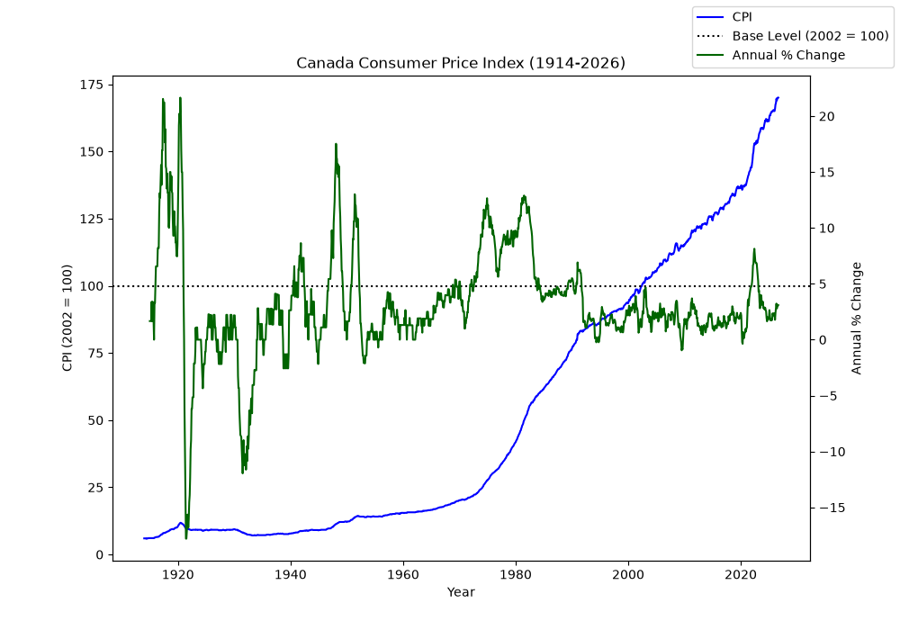

# FINE3300-2026-A2
**FINE 3300 - Fall 2026**

FINE 3300 Assignment 2: Enhanced Inflation Calculator using Bank of Canada CPI data

# Monthly Inflation Calculator

## Description
This code enhances the Bank of Canada inflation calculator. This calculator allows the user to compare prices between any two months from January 1914 to September 2026.

## How It Works:
- Reads the Bank of Canada CPI file
- Graphs the CPI and annual % change and saves it as cpi_graph.png
- Asks the user for a price and two dates (YYYY-MM), and checks that the price is above $0 and both dates are in the data
- Uses the CPI for each date to calculate the new price, percent change, number of years and average annual rate of inflation

## How to Use:
Keep the CSV file in the same folder as the code, then run all the cells in order and answer the prompts. Dates must be entered as YYYY-MM.

## CPI Graph

## Graph Insights:
- *1920-1921:* The annual % change dipped heavily right after a big spike in 1920, and the CPI dropped before it continued to rise gradually.
- *1930s:* The annual % change went negative for a few years during the Great Depression as prices were decreasing.
- *1970s-1980s:* The annual % change was consistently high for many years.
- *2021-2022:* The annual % change spiked recently, the highest in about 40 years.

## Sample Output
A basket of goods and services that cost: $ 100.0 in 2000-01 would cost: $ 176.47 in 2026-01
Percent change: 76.47
Number of years: 26
Average annual rate of inflation (%): 2.21
CPI for first date: (2000-01) 93.5
CPI for second date: (2026-01) 165.0
